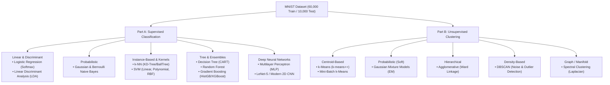
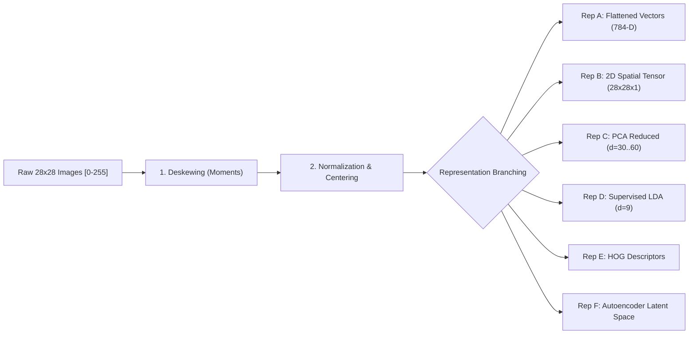
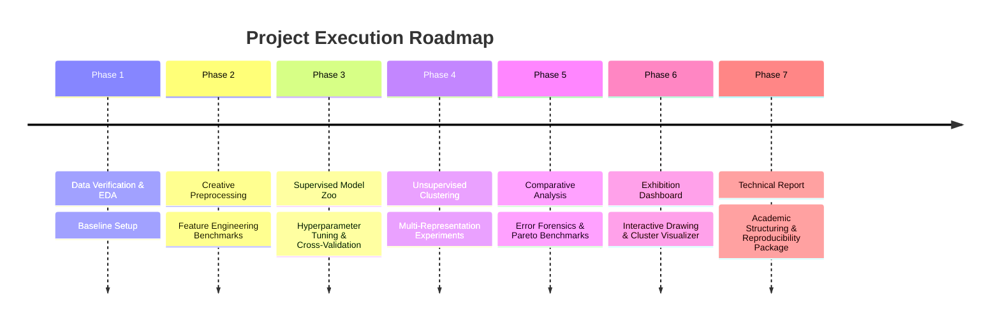

# EE5130 Mini Project: End-to-End Machine Learning Implementation Plan
**Course:** EE5130 – Artificial Intelligence and Machine Learning (30% Course Weight)  
**Project Title:** Comparative Study of Supervised Classification and Unsupervised Clustering Techniques Using the MNIST Dataset  
**Objective:** Design, systematically benchmark, visualize, and deploy an academic-grade machine learning pipeline covering classical ML, deep learning, unsupervised manifold clustering, and an interactive exhibition demonstration.

---

## 1. Executive Summary & Assessment Rubric Alignment

The project requires far more than training isolated models; the guideline emphasizes **practical implementation, systematic experimentation, quantitative evaluation, high-dimensional visualization, and critical interpretation of errors and trade-offs**.

### Marks Distribution Breakdown (Total: 100 Marks)
| Assessment Component | Marks | Critical Success Factors in Our Plan |
| :--- | :---: | :--- |
| **Classification Implementation & Breadth** | **20** | Broad spectrum of models: Linear/Discriminant (Logistic, LDA), Probabilistic (Naive Bayes), Non-parametric (k-NN), Kernel methods (Linear/RBF SVM), Ensembles (Random Forest, HistGradientBoosting/XGBoost), and Deep Learning (MLP, LeNet/Modern CNN). |
| **Classification Evaluation & Comparative Analysis** | **20** | Strict protocol without data leakage; macro/weighted/micro metrics; confusion matrix diagnostics; ROC/AUC curves; training vs inference time benchmarks; error forensics. |
| **Clustering Implementation & Breadth** | **15** | Centroid-based (k-Means, Mini-Batch k-Means), Density-based (DBSCAN), Probabilistic (GMM), Hierarchical (Agglomerative), and Manifold (Spectral). Multi-representation clustering (raw pixels, PCA, Autoencoder bottleneck). |
| **Clustering Evaluation, Visualization & Interpretation** | **20** | Unsupervised internal metrics (Silhouette, Davies-Bouldin, Calinski-Harabasz), external ground-truth validation (ARI, NMI, Homogeneity, Completeness, V-measure, Purity via Hungarian matching), 2D/3D projections (PCA, t-SNE, UMAP), cluster prototype images. |
| **Technical Report Quality & Reproducibility** | **15** | Structured IEEE/academic format (Sections 7.1–7.8), automated result tables, high-resolution vector figures, modular reproducible codebase with seeded RNGs. |
| **Mini Exhibition, Demonstration & Communication** | **10** | Interactive web dashboard (live digit drawing canvas, multi-model real-time predictions, confidence distributions, and interactive cluster space locator). |

---

## 2. Complete Model Zoo & Pedagogical Learning Map

Through this project, you will gain hands-on mastery over **16 distinct machine learning and deep learning algorithms**, understanding their mathematical foundations, inductive biases, strengths, and failure modes on high-dimensional image data.



### 2.1 Supervised Classification Models
1. **Multinomial Logistic Regression (Softmax)**:
   - *Concept*: Generalized linear model estimating class posterior probabilities via the softmax function with Cross-Entropy Loss and $L_1/L_2$ regularization.
   - *Learning Outcome*: Understand linear hyperplanes in 784-D space, multiclass decision boundaries, and why linear classifiers struggle with non-linear digit variations.
2. **Linear Discriminant Analysis (LDA)**:
   - *Concept*: Maximizes between-class variance relative to within-class variance (Fisher's criterion), reducing 784 dimensions to at most $C-1 = 9$ discriminative axes.
   - *Learning Outcome*: Supervised dimensionality reduction vs. classification; assumptions of equal class covariance matrices.
3. **Naive Bayes (Gaussian & Bernoulli)**:
   - *Concept*: Bayes' theorem with the strong conditional independence assumption given class labels.
   - *Learning Outcome*: Impact of pixel correlation violations (adjacent pixels are strongly correlated); baseline for fast probabilistic inference.
4. **k-Nearest Neighbors (k-NN)**:
   - *Concept*: Non-parametric, lazy learner assigning labels based on Euclidean distance in pixel space using spatial index trees (KD-Tree / Ball-Tree).
   - *Learning Outcome*: Curse of dimensionality in 784-D; sensitivity to distance metric, pixel shifts, and computational cost ($O(N \cdot D)$ inference latency).
5. **Support Vector Machines (SVM - Linear & RBF Kernels)**:
   - *Concept*: Maximal margin hyperplane classification. Kernel trick ($\phi(x)$ mapping via Radial Basis Function) allows non-linear separation.
   - *Learning Outcome*: Support vectors selection, regularization parameter $C$, kernel bandwidth $\gamma$, and trade-off between linear speed vs. non-linear RBF accuracy.
6. **Decision Trees (CART)**:
   - *Concept*: Recursive axis-aligned binary splits optimizing Gini impurity or Information Gain (Entropy).
   - *Learning Outcome*: Visualizing interpretability; understanding overfitting tendencies on raw pixel grids without spatial invariance.
7. **Random Forest (Bagging)**:
   - *Concept*: Ensemble of de-correlated decision trees trained on bootstrap samples with random feature subsets.
   - *Learning Outcome*: Variance reduction, Out-Of-Bag (OOB) error estimation, and computing pixel importance heatmaps across the 28x28 grid.
8. **Gradient Boosting (HistGradientBoosting / XGBoost)**:
   - *Concept*: Sequential additive ensemble where each new tree fits the negative gradient (pseudo-residuals) of the loss function.
   - *Learning Outcome*: State-of-the-art tabular performance on flattened image descriptors; histogram-based binning for extreme speedup.
9. **Multilayer Perceptron (MLP)**:
   - *Concept*: Fully connected feedforward artificial neural network with non-linear activation functions (ReLU, GELU), Dropout, Batch Normalization, and Backpropagation via Adam optimizer.
   - *Learning Outcome*: Non-linear function approximation, vanishing gradients, weight initialization, and capacity vs. generalization.
10. **Convolutional Neural Networks (CNN - LeNet-5 & Modern 2D ConvNet)**:
    - *Concept*: Exploits spatial locality and translation invariance using 2D convolution filters, weight sharing, receptive fields, and pooling layers.
    - *Learning Outcome*: Spatial hierarchy of features (edges $\rightarrow$ curves $\rightarrow$ digit loops); why CNNs dominate computer vision compared to flattened vector models.

---

### 2.2 Unsupervised Clustering Models
1. **k-Means Clustering ($k$-means++)**:
   - *Concept*: Partitioning $N$ samples into $k$ Voronoi cells by iteratively updating centroids to minimize Within-Cluster Sum of Squares (Inertia/WCSS).
   - *Learning Outcome*: Sensitivity to initialization ($k$-means++ seeding), spherical cluster assumption, and finding optimum $k$ via Elbow & Silhouette curves.
2. **Mini-Batch k-Means**:
   - *Concept*: Stochastic optimization using small random subsets to update centroids, drastically cutting memory and convergence time.
   - *Learning Outcome*: Algorithmic scaling for big data pipelines and convergence quality comparison against batch $k$-Means.
3. **Gaussian Mixture Models (GMM)**:
   - *Concept*: Soft probabilistic generative clustering where each cluster is modeled as a multivariate Gaussian parameterized by mean $\mu_k$ and covariance $\Sigma_k$, solved via Expectation-Maximization (EM).
   - *Learning Outcome*: Soft assignment (probabilities of belonging to multiple digit styles), covariance constraints (full, tied, diagonal, spherical), and model selection via BIC/AIC.
4. **Agglomerative Hierarchical Clustering**:
   - *Concept*: Bottom-up hierarchical merging based on distance metrics and linkage criteria (Ward's minimum variance, average, complete).
   - *Learning Outcome*: Dendrogram visualization, multi-level hierarchy analysis (e.g. how digits 3, 5, 8 merge higher up), and $O(N^2)$ memory limits requiring representative subsetting.
5. **DBSCAN (Density-Based Spatial Clustering of Applications with Noise)**:
   - *Concept*: Discovers dense clusters separated by low-density regions based on neighborhood radius ($\varepsilon$) and minimum points ($MinPts$).
   - *Learning Outcome*: Identifying natural non-spherical clusters; automatic discovery of cluster count; isolating strange, illegible handwriting as noise points (-1 label).
6. **Spectral Clustering**:
   - *Concept*: Constructs a graph adjacency/affinity matrix from pairwise similarities, computes graph Laplacian eigenvectors, and clusters in the low-dimensional spectral embedding.
   - *Learning Outcome*: Graph cut theory, manifold learning, and non-linear cluster separation.

---

## 3. Creative & Technical Preprocessing & Feature Engineering

The project guideline requires investigating alternative preprocessing and feature representations. Every transformation will strictly adhere to the academic integrity rule: **parameters fitted on the training split only and applied downstream to prevent data leakage**.



### Preprocessing Techniques Matrix
| Technique | Implementation Details | Purpose & Educational Insight |
| :--- | :--- | :--- |
| **1. Strict Dataset Splitting** | Preserve standard 60k train / 10k test split. Create stratified 10k validation set from training pool. | Foundation of ML rigor. Zero leakage into validation/test splits. |
| **2. Intensity Normalization** | Min-Max $[0, 1]$ ($X / 255.0$) and Standard Z-Score scaling $(\frac{X - \mu}{\sigma})$. | Prevents gradient explosion in neural nets; ensures fair distance metrics in k-NN and SVM. |
| **3. Center-of-Mass Centering** | Calculate image spatial centroid using image moments: $\bar{x} = \frac{m_{10}}{m_{00}}, \bar{y} = \frac{m_{01}}{m_{00}}$, shift digit center to $(14, 14)$. | Removes translation variance across different handwriting positions. |
| **4. Deskewing (Shear Correction)** | Compute covariance of pixel intensities: $\text{cov} = \frac{\mu_{11}}{\mu_{02}}$, apply affine transformation $x' = x - \text{skew} \cdot y$. | Corrects slanted handwriting styles (e.g. tilted '1's, '7's), significantly boosting classical ML accuracy. |
| **5. Morphological Denoising & Thresholding** | Otsu's adaptive binarization, subtle Gaussian smoothing, and morphological dilation/erosion. | Removes edge sensor noise and standardizes stroke thickness. |
| **6. Dimensionality Reduction (PCA)** | Fit PCA on training vectors. Compute scree plot of cumulative explained variance ($80\%, 90\%, 95\%$). | Eliminates uninformative background pixels (margins); mitigates the curse of dimensionality for k-NN and clustering. |
| **7. Supervised Discriminant Features (LDA)** | Linear projection to $C-1 = 9$ axes maximizing class separation. | Drastically compresses feature space while preserving digit discriminability. |
| **8. Computer Vision Descriptors (HOG)** | Histogram of Oriented Gradients: extract local gradient directions and magnitudes in $4\times 4$ cells. | Captures edge orientations and structural stroke strokes invariant to illumination/intensity. |
| **9. Deep Feature Extraction (Autoencoder)** | Train an unsupervised Convolutional Autoencoder (Encoder $\rightarrow$ Bottleneck $\rightarrow$ Decoder). Extract 16-D or 32-D latent code. | Nonlinear manifold representation for downstream clustering; tests how learned neural features compare to PCA. |
| **10. Data Augmentation (for CNN)** | Random affine rotations ($\pm 10^\circ$), subtle translation ($\pm 2$ px), random zoom ($0.9 - 1.1\times$). | Teaches CNN invariant representations and prevents overfitting. |

---

## 4. Comprehensive Visualization Techniques

Visualization is a major grading pillar (20 marks in clustering + 20 in classification analysis). We will generate publication-quality figures:

### 4.1 Exploratory Data Analysis (EDA) Visualizations
- **10x10 Digit Grid**: 10 random samples per class displaying natural intra-class handwriting variety.
- **Class Distribution Histogram**: Confirming class balance across the 60,000 training samples.
- **Digit Mean & Variance Archetypes**: 28x28 heatmaps showing the "average digit" and pixel variance for each class 0–9 (revealing which regions have highest uncertainty).
- **Pixel Intensity Distributions**: Histograms comparing raw pixels vs. standardized vs. deskewed pixels.

### 4.2 High-Dimensional Projection Visualizations
- **2D & 3D PCA Projection**: Global linear variance distribution of MNIST digits.
- **2D t-SNE (t-Distributed Stochastic Neighbor Embedding)**: Preserves local neighborhoods; visualizes natural non-linear manifold digit separation.
- **2D UMAP (Uniform Manifold Approximation and Projection)**: Preserves both local and global cluster structures with high computational efficiency.
- **Dual-View Manifolds**: Side-by-side scatter plots: Left colored by **Ground Truth Labels**, Right colored by **Unsupervised Cluster IDs**.

### 4.3 Classification Diagnostics Visualizations
- **Dual Confusion Matrices**:
  1. Raw sample count confusion matrix.
  2. Row-normalized percentage confusion matrix with annotated percentages and colorbar.
- **Per-Class Precision, Recall, and F1-Score Radar / Bar Chart**: Immediately reveals difficult digits (e.g., digit 8 vs digit 3).
- **Multiclass One-vs-Rest (OvR) ROC & Precision-Recall Curves**: Macro-averaged and individual per-digit ROC curves with AUC annotations.
- **Learning & Validation Curves**: Training vs. Validation loss and accuracy plotted against training set size (data efficiency) and training epochs (overfitting diagnostics).
- **Qualitative Error Gallery**: A visual diagnostic panel displaying the top 25 most confident false predictions (e.g. Ground Truth = 4, Predicted = 9 with 98% confidence) with image, true label, predicted label, and model probability distribution.

### 4.4 Clustering & Structure Visualizations
- **Cluster Prototype Grid**: The centroid / medoid of each discovered cluster reconstructed into a 28x28 image to visually interpret what each cluster represents.
- **Cluster Label Purity Stacked Bar Chart**: Shows the exact breakdown of true digit classes composing each discovered cluster.
- **Silhouette Coefficient Plots**: Thickness of silhouette silhouettes representing cluster size and coefficient score distribution for each cluster.
- **Elbow / Inertia Curves & Gap Statistic**: WCSS vs. $k$ (for $k \in [2, 16]$) with knee-point detection.
- **Hierarchical Dendrogram**: Truncated tree diagram for Agglomerative clustering illustrating the taxonomy of digit similarities.
- **Sub-Style Discovery Gallery**: Visual proof of multiple clusters capturing distinct handwriting styles of the same digit (e.g. European crossed '7' vs standard straight '7'; looped '2' vs smooth '2').

---

## 5. Quantitative Model Evaluation & Benchmarking Suite

### 5.1 Classification Metrics
1. **Accuracy**: Overall fraction of correct predictions.
2. **Precision, Recall, and F1-Score**:
   - **Macro-Averaging**: Computes metric independently per digit and averages equally (evaluates balanced performance regardless of class frequencies).
   - **Weighted-Averaging**: Weights per-digit metrics by true class support.
   - **Micro-Averaging**: Global aggregation of true positives, false negatives, and false positives.
3. **One-vs-Rest (OvR) ROC-AUC**: Measures discriminative capability across all decision thresholds.
4. **Computational Efficiency Metrics**:
   - **Training Time (seconds)**: Wall-clock duration to fit on CPU/GPU.
   - **Inference Latency (milliseconds per 1,000 samples)**: Real-time suitability.
   - **Model Footprint**: Disk storage (MB) and memory consumption.
5. **Pareto Trade-off Analysis**: Scatter plot of **Accuracy vs. Inference Latency (Log Scale)** to identify optimal production models.

### 5.2 Clustering Evaluation Metrics
1. **Internal Validation (Unsupervised - Without Ground Truth)**:
   - **Silhouette Score**: Measures how similar an object is to its own cluster compared to neighboring clusters $[-1, +1]$.
   - **Davies-Bouldin Index (DBI)**: Ratio of within-cluster distances to between-cluster distances (lower is better).
   - **Calinski-Harabasz Index (CHI)**: Variance ratio criterion of between-cluster to within-cluster dispersion (higher is better).
   - **Within-Cluster Sum of Squares (Inertia)**: Geometric compactness of clusters.
2. **External Validation (Supervised - Comparing Clusters to True Digit Labels)**:
   - **Adjusted Rand Index (ARI)**: Pairwise similarity adjusted for chance $[-1, +1]$.
   - **Normalized Mutual Information (NMI)**: Information-theoretic mutual dependence $[0, 1]$.
   - **Homogeneity, Completeness, and V-Measure**:
     - *Homogeneity*: Each cluster contains only members of a single class.
     - *Completeness*: All members of a given class are assigned to the same cluster.
     - *V-Measure*: Harmonic mean of homogeneity and completeness.
   - **Cluster Purity & Bipartite Mapping**: Use the **Hungarian algorithm (Kuhn-Munkres)** to find the optimal one-to-one assignment between cluster index and true digit class, enabling a pseudo-accuracy metric.

---

## 6. Mini Exhibition & Interactive Demonstration Plan

The guideline allocates 10 marks to the **Mini Exhibition and Final Presentation**, emphasizing clear technical communication and working demonstrations where visitors can interact with the system.

### Interactive Exhibition Web Application
We plan an interactive web application (using Streamlit or a standalone high-performance local dashboard) featuring:
1. **Interactive Digit Drawing Canvas**:
   - Visitors can draw any digit using their mouse or touch screen.
   - Live pre-processing visualizer: Shows the raw drawn canvas $\rightarrow$ auto-centered & cropped $28\times 28$ image $\rightarrow$ deskewed & normalized tensor in real-time.
2. **Multi-Model Head-to-Head Arena**:
   - Visitors draw a digit and simultaneously view predictions from 3 selected archetypes:
     - Classical Linear: Logistic Regression
     - Non-Linear Kernel: SVM (RBF)
     - Deep Learning: Convolutional Neural Network (CNN)
   - Real-time animated probability confidence bars.
3. **Interactive Latent Space Explorer**:
   - Real-time projection: The visitor's drawn digit is projected into the pre-computed 2D UMAP / PCA cluster space!
   - A pulsing target marker shows exactly which cluster neighborhood the visitor's handwriting landed in, identifying neighboring database digits.
4. **Failure Forensics & "Trick the AI" Section**:
   - Curated gallery of ambiguous and adversarial digits that fool classical models but succeed on CNNs (or vice-versa), explaining *why* handwriting styles create classification boundaries.

---

## 7. Step-by-Step Phased Implementation Roadmap

To maintain strict organization, code readability, and modularity, the project will be structured in 7 logical phases:



### Phase 1: Environment, Dataset Verification & Exploratory Data Analysis (EDA)
- Load `mnist_train.csv` (60,000 samples) and `mnist_test.csv` (10,000 samples).
- Verify data integrity: check for missing values, pixel intensity ranges ($[0, 255]$), label distributions.
- Create stratified validation split (50,000 train / 10,000 val / 10,000 test).
- Generate initial EDA figures: 10x10 digit gallery, average digit templates, pixel variance maps.

### Phase 2: Feature Engineering & Preprocessing Pipeline
- Build modular, scikit-learn compatible transformer classes:
  - `ImageDeskewer`: Spatial moment analysis and affine shear correction.
  - `ImageNormalizer`: MinMax and Standard scaling.
  - `CentroidAligner`: Center-of-mass translation to $(14, 14)$.
  - `HOGExtractor`: Histogram of Oriented Gradients feature extraction.
  - `PCAReducer`: PCA dimension reduction retaining $80\%, 90\%, 95\%$ variance.
  - `ConvolutionalAutoencoder`: PyTorch/TensorFlow encoder for unsupervised latent codes.
- Benchmark preprocessing impact: Run a baseline classifier across (Raw vs. Normalized vs. Deskewed vs. PCA vs. HOG) to document quantitative performance improvements.

### Phase 3: Part A – Supervised Classification Experiments
- Implement and systematically tune all 10 classifiers:
  - Logistic Regression (tuning $C$, penalty $L_1/L_2$, solver `saga`/`lbfgs`).
  - LDA (shrinkage, solver).
  - Naive Bayes (Gaussian vs. Bernoulli with binarization threshold).
  - k-NN (tuning $k \in [1, 3, 5, 7, 9, 15]$, distance metrics: Euclidean, Manhattan, Cosine).
  - SVM (Linear vs. RBF, tuning $C \in [0.1, 1, 10]$, $\gamma \in [\text{'scale'}, 0.01, 0.001]$).
  - Decision Trees (tuning `max_depth`, `min_samples_split`).
  - Random Forest (tuning `n_estimators`, `max_features`, `max_depth`).
  - HistGradientBoosting (tuning `learning_rate`, `max_iter`, `l2_regularization`).
  - Multilayer Perceptron (MLP) (architecture experiments: 1 vs 2 hidden layers, Dropout, Adam optimizer).
  - CNN (LeNet-5 variant with Conv2D $\rightarrow$ BatchNorm $\rightarrow$ ReLU $\rightarrow$ MaxPool $\rightarrow$ Conv2D $\rightarrow$ Dense $\rightarrow$ Dropout).
- Log training time, inference latency, memory, validation accuracy, and F1-scores.
- Select top candidate models and evaluate on untouched test set.

### Phase 4: Part B – Unsupervised Learning & Clustering Experiments
- Run clustering algorithms on:
  - Representation 1: Normalized raw pixels (784-D).
  - Representation 2: PCA-reduced vectors (e.g. 50-D).
  - Representation 3: Autoencoder latent space (16-D).
- Execute clustering algorithms:
  - k-Means with $k$-means++ seeding ($k=10$, plus $k \in [5, 15]$ for elbow and silhouette analysis).
  - Mini-Batch k-Means (benchmark speedup vs. standard k-Means).
  - Gaussian Mixture Models (GMM) with full vs. diagonal covariance.
  - Agglomerative Hierarchical Clustering (Ward linkage, explore dendrogram).
  - DBSCAN (tune $\varepsilon$ and $MinPts$, record percentage of outliers identified as noise).
  - Spectral Clustering on PCA projection.
- Compute internal metrics (Silhouette, Davies-Bouldin, Calinski-Harabasz).
- Compute external metrics using test labels (ARI, NMI, Homogeneity, Completeness, V-Measure, Purity via Hungarian matching).
- Generate 2D UMAP / t-SNE projections comparing cluster assignments to ground truth.

### Phase 5: Deep Comparative Analysis & Error Forensics
- Construct consolidated master comparative tables:
  - Supervised summary: Accuracy, Precision, Recall, F1 (macro/weighted), AUC, Train Time, Inference Latency, Model Size.
  - Unsupervised summary: Representation, Silhouette, Davies-Bouldin, Calinski-Harabasz, ARI, NMI, V-Measure.
- Conduct in-depth error forensics:
  - Digits with highest error rates (e.g. why '4' and '9' or '3' and '5' confuse classifiers).
  - Inspect cluster sub-styles (discovering whether European-style '7's cluster away from plain '7's).
  - Accuracy vs. Latency Pareto analysis.

### Phase 6: Interactive Exhibition Application (Demo)
- Build a lightweight, responsive exhibition dashboard.
- Integrate interactive canvas drawing, live pre-processing visualization, real-time prediction from multiple models, and projection into the cluster latent map.
- Prepare visual display material and presentation guidelines for the mini exhibition.

### Phase 7: Technical Report Preparation & Reproducibility Materials
- Compile the formal academic technical report strictly adhering to Sections 7.1–7.8:
  - 7.1 Introduction & Objectives
  - 7.2 Experimental Setup (environment, partitions, hardware, hyperparameters)
  - 7.3 Classification Experiments & Diagnostics
  - 7.4 Clustering Experiments & Structural Interpretations
  - 7.5 Comparative Results, Trade-Off Discussions & Pareto Frontiers
  - 7.6 Conclusions & Future Work
  - 7.7 References
  - 7.8 Reproducibility Materials & Execution Guide
- Clean, modularize, and document all source scripts with seeds for 100% deterministic reproducibility.

---

## 8. Proposed Modular Directory Structure

```text
EE5130_ML_Project/
│
├── EE5130_Mini_Project.pdf          # Official project specification guideline
├── mnist_train.csv                  # 60,000 training samples
├── mnist_test.csv                   # 10,000 test samples
│
├── src/                             # Core Python modules
│   ├── __init__.py
│   ├── data_loader.py               # Robust CSV ingestion, validation, splitting
│   ├── preprocessing.py             # Normalization, deskewing, centering, HOG
│   ├── dimensionality.py            # PCA, LDA, Autoencoders, t-SNE, UMAP
│   ├── classification_models.py     # Classical, Ensemble & Neural Network wrappers
│   ├── clustering_models.py         # k-Means, GMM, Hierarchical, DBSCAN, Spectral
│   ├── evaluation.py                # Multiclass metrics, internal/external cluster scores
│   └── visualization.py             # Publication-ready plots, heatmaps, manifold charts
│
├── experiments/                     # Automated, reproducible experiment runners
│   ├── run_eda.py                   # Generates data overview and archetype figures
│   ├── run_preprocessing_bench.py   # Compares raw vs deskewed vs PCA vs HOG
│   ├── run_classification.py        # Trains and benchmarks all supervised models
│   ├── run_clustering.py            # Executes all clustering algorithms & representations
│   └── run_pareto_analysis.py       # Benchmarks speed, memory, and accuracy trade-offs
│
├── outputs/                         # Generated artifacts
│   ├── figures/                     # All PNG/SVG figures for report & exhibition
│   ├── tables/                      # LaTeX and Markdown summary tables
│   ├── saved_models/                # Serialized weights (joblib / safetensors)
│   └── embeddings/                  # Cached 2D UMAP / t-SNE coordinates
│
├── demo/                            # Mini Exhibition Interactive Application
│   └── app.py                       # Interactive drawing canvas & cluster explorer
│
├── report/                          # Final Submission Materials
│   └── Technical_Report.md          # Comprehensive academic report (Sections 7.1 - 7.8)
│
└── README.md                        # Master reproduction guide & execution commands
```

---

## 9. Next Steps & User Confirmation

> [!IMPORTANT]
> **Strict Adherence to Instructions:**
> No code, models, or report files have been created in the workspace yet.
> The implementation will begin only when you give the green light.
> 
> You can choose to proceed with:
> 1. Approving the plan as is, or requesting adjustments (e.g. focusing on specific models or neural architectures).
> 2. Initiating **Phase 1 (Data Verification, Splitting & Exploratory Data Analysis)**.
